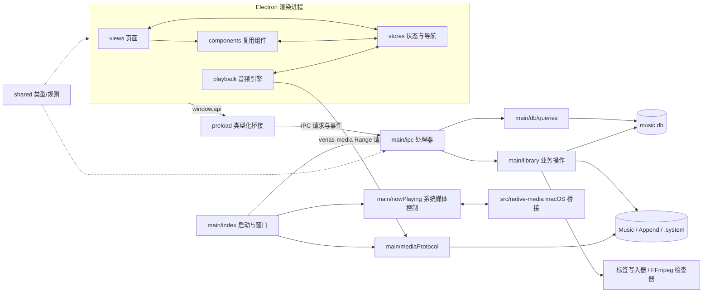

# VENAS 项目架构与文件职责

本文对应当前源码。`src/` 是应用源码，`scripts/` 是构建与测试工具，`tests/` 是隔离测试；用户音乐库及数据库不在仓库内。文件职责按路径列出，便于定位改动入口。

## 架构图

**边界约定：** 渲染进程通过 `window.api` 访问本地资源，不能直接访问 SQLite 或任意磁盘路径；主进程负责数据库、文件操作、工具任务和 IPC。播放音频由渲染进程的 Chromium 音频引擎完成，`venas-media` 协议由主进程按字节范围提供文件。封面列表读取走 IPC 和渲染进程缩略图缓存，封面更新通过 IPC 广播精确失效。

**运行数据：** `<音乐根目录>/Append` 是待导入区，`<音乐根目录>/Music` 存放已入库音频与导出的 `Playlist`；`<系统根目录>/.system/database/music.db` 是 SQLite 数据库，`.system/assets` 存放歌曲、专辑、艺术家图片，`.system/tools` 存放本地工具。Electron 设置文件存音乐/系统目录和播放后端等偏好，不等同于音乐数据库。

## 根目录与文档

| 文件/目录                                                        | 职责                                        |
| ------------------------------------------------------------ | ----------------------------------------- |
| `package.json` / `package-lock.json`                         | 依赖、命令、打包资源清单及锁定版本。                        |
| `electron.vite.config.ts`                                    | Electron 主进程、preload、渲染进程构建入口和配置。         |
| `tsconfig.json` / `tsconfig.node.json` / `tsconfig.web.json` | TypeScript 公共、Node/Electron 与 Web 类型检查配置。 |
| `.gitignore`                                                 | 排除依赖、构建产物和本地生成文件。                         |
| `README.md`                                                  | 安装、构建、运行和用户功能说明。                          |
| `本地播放器搭建.md`                                                 | 产品目标与原始设计规范。                              |
| `tag.md`                                                     | Tag 分类的项目资料。                              |
| `docs/audio-tag-writeback-handoff.md`                        | 音频标签写入的格式映射、维护与验证记录。                      |
| `docs/architecture.md`                                       | 本架构图和源码职责索引。                              |
| `resources/audio-tags/`                                      | 构建出的原生标签写入器、动态库及许可证；由构建脚本管理。              |
| `resources/audio-inspect/`                                   | 构建出的精简 FFmpeg、源码/许可证与构建信息；由构建脚本管理。        |
| `resources/native-media/`                                    | macOS Now Playing 原生模块，由本机构建脚本生成。         |
| `node_modules/`、`out/`、`dist/`                               | 依赖、编译输出和安装包产物，不是业务源码。                     |

## `src/main/`：Electron 主进程

| 文件                               | 职责                                                                  |
| -------------------------------- | ------------------------------------------------------------------- |
| `index.ts`                       | 配置音频输出、创建窗口、初始化音乐库、启动备份/修复并注册 IPC 与媒体协议。                            |
| `mediaProtocol.ts`               | 注册 `venas-media`，校验文件名、提供音频 MIME 与 HTTP Range/seek 响应。              |
| `windowBroadcast.ts`             | 向所有存活窗口广播主进程状态事件。                                                   |
| `audioOutput.ts`                 | 配置 macOS Chromium 音频输出后端及其运行状态。                                     |
| `nowPlaying.ts`                  | 加载 macOS Now Playing 桥接，发布播放状态并接收系统媒体命令；其他平台不启用。                    |
| `../native-media/venas_media.mm` | 对接 MPRemoteCommandCenter 与 MPNowPlayingInfoCenter，处理耳机/系统媒体控制及资源释放。 |
| `settings.ts`                    | Electron 设置文件的读写与设置类型。                                              |
| `ipc/index.ts`                   | 注册 Append、歌曲、艺术家、专辑、Tag、播放、导航和设置等 IPC 通道；编排长任务及事件。                  |

### `src/main/db/`

| 文件                    | 职责                               |
| --------------------- | -------------------------------- |
| `index.ts`            | 打开/关闭 SQLite、初始化 schema 和执行兼容迁移。 |
| `schema.ts`           | 数据库表、关联表和索引定义。                   |
| `queries/albums.ts`   | 专辑、专辑艺术家/厂牌与专辑歌曲查询和更新。           |
| `queries/artists.ts`  | 艺术家、厂牌、成员、别名、搜索及关联歌曲查询。          |
| `queries/labels.ts`   | 厂牌列表、详情及其专辑分组查询。                 |
| `queries/songInfo.ts` | 歌曲补充信息、播放日期的读写。                  |
| `queries/songList.ts` | 为歌曲列表批量补齐艺术家显示名。                 |
| `queries/songs.ts`    | 歌曲列表、详情、搜索和歌曲关联的读写。              |
| `queries/tags.ts`     | Tag 分类、歌曲关联、评论及排序的读写。            |

### `src/main/library/`

| 文件                         | 职责                              |
| -------------------------- | ------------------------------- |
| `artistMaintenance.ts`     | 删除或合并艺术家及相关图片。                  |
| `artistParser.ts`          | 从音频元数据解析艺术家和 feat. 信息。          |
| `artistSelection.ts`       | 入库/编辑时解析已有或新建的艺术家选择。            |
| `audioFileHash.ts`         | 流式计算音频文件哈希、判断文件身份。              |
| `audioFileOperations.ts`   | 将音频替换、删除与后台读写任务串行化。             |
| `audioIntegrity.ts`        | 全曲解码检查任务、状态记录和进度发布。             |
| `audioMetadata.ts`         | 音频元数据读取的统一入口。                   |
| `audioTagInspection.mjs`   | 解析 ID3/Ogg/MP4 结构，用于标签写入后的验证。   |
| `audioTagIntegrity.ts`     | 非 FLAC 格式的标签及音频内容校验。            |
| `audioTagValues.ts`        | 将数据库歌曲信息映射为 FLAC 标签值。           |
| `audioTagWorker.ts`        | 后台标签写入工作线程。                     |
| `audioTagWriteback.ts`     | 全库标签写入任务、跳过条件、进度和状态持久化。         |
| `backup.ts`                | 每日数据库备份。                        |
| `coverCache.ts`            | 写入歌曲/专辑/艺术家图片和封面缓存。             |
| `coverUpdates.ts`          | 计算封面变动影响的歌曲、专辑和艺术家 ID。          |
| `deleteSong.ts`            | 删除歌曲音频、数据库记录及相关孤儿资源。            |
| `flacTags.ts`              | FLAC 标签复制写入与原音频数据保护。            |
| `health.ts`                | 扫描缺失音频/封面、孤儿图片、空专辑/艺术家和重名记录。    |
| `healthCleanup.ts`         | 清理确认过的无歌曲专辑及艺术家/厂牌。             |
| `ingest.ts`                | 将 Append 音频和编辑信息入库。             |
| `init.ts`                  | 创建音乐库目录并初始化数据库。                 |
| `m4aCoverTiming.ts`        | 判断 M4A 封面流时间基警告能否安全忽略。          |
| `maintenance.ts`           | 协调排他维护任务及其 UI 状态。               |
| `migratedAppendSources.ts` | 临时记录入库/重命名后的旧播放路径映射。            |
| `ncmCover.ts`              | 为 NCM 转换准备本地封面。                 |
| `neteaseImport.ts`         | 导入网易云目录根层文件、解码 NCM 并移动到 Append。 |
| `neteaseTags.ts`           | 识别和处理网易云 `163 key` 标签。          |
| `orphanCleanup.ts`         | 收集并清理编辑后失去歌曲关联的专辑/艺术家及图片。       |
| `paths.ts`                 | 从音乐/系统根目录推导实际文件路径。              |
| `playbackInfo.ts`          | 读取播放文件信息及音频格式参数。                |
| `playlistExport.ts`        | 从 Tag 快照生成并安全替换 M3U 歌单目录。       |
| `reload.ts`                | 替换/重命名音频及重载/设置封面。               |
| `repairDurations.ts`       | 启动时修复缺失的 Ogg 时长。                |
| `scanner.ts`               | 扫描 Append 文件及读取待入库封面。           |
| `systemMigration.ts`       | 复制、校验并切换 `.system` 目录。          |

## `src/preload/` 与 `src/shared/`

| 文件                          | 职责                                |
| --------------------------- | --------------------------------- |
| `preload/index.ts`          | 将允许的 IPC 方法和事件订阅暴露为 `window.api`。 |
| `preload/window.d.ts`       | 为渲染进程声明 `window.api` 类型。          |
| `shared/artistSelection.ts` | 跨进程共享的艺术家选择规则/类型。                 |
| `shared/colors.ts`          | 应用共享颜色常量。                         |
| `shared/searchTerms.ts`     | 统一搜索词拆分与匹配辅助逻辑。                   |
| `shared/tagOrdering.ts`     | Tag 字母序及 Month/Year 时间序规则。        |
| `shared/types.ts`           | IPC 载荷、实体、任务状态、会话与导航等共享类型。        |

## `src/renderer/`：React 界面

| 文件                       | 职责                      |
| ------------------------ | ----------------------- |
| `index.html`             | 渲染进程 HTML 入口。           |
| `src/main.tsx`           | 挂载 React 应用并引入全局样式。     |
| `src/App.tsx`            | 应用外壳、侧栏路由、播放层、快捷键和会话恢复。 |
| `src/playbackHelpers.ts` | 时间格式化及播放进度显示辅助。         |
| `src/playerTracks.ts`    | 音乐库歌曲到播放队列条目的映射。        |
| `src/songSearch.ts`      | 前端列表的搜索和排序。             |
| `src/tagTypes.ts`        | Tag 类型选项。               |
| `src/coverUpdates.ts`    | 将主进程封面更新事件转发给页面缓存。      |
| `src/thumbnailCache.ts`  | 缩略图共享加载、可见性观察与精确失效。     |

### `src/renderer/src/assets/`、`constants/`、`hooks/`

| 文件                              | 职责                                            |
| ------------------------------- | --------------------------------------------- |
| `assets/colors.css`             | 全局 CSS 颜色变量。                                  |
| `assets/main.css`               | 应用布局、控件、滚动条和基础样式。                             |
| `assets/audio-visualizer.css`   | 无歌词时的音频可视化样式。                                 |
| `constants/albumTypes.ts`       | 专辑类型建议值。                                      |
| `hooks/useCoverUrl.ts`          | 加载完整封面、管理 object URL 生命周期，并提供原图/缩略图共用的定向刷新订阅。 |
| `hooks/useThumbnailCoverUrl.ts` | 可见时获取共享缩略图并释放引用。                              |
| `hooks/useDismissibleLayer.ts`  | 点击弹层外部关闭的交互。                                  |
| `hooks/useListPlayback.ts`      | 列表双击与随机播放的共用动作。                               |
| `hooks/useTaskProgress.ts`      | 后台任务进度订阅、启动与停止。                               |

### `src/renderer/src/stores/`、`playback/`

| 文件                               | 职责                                  |
| -------------------------------- | ----------------------------------- |
| `stores/libraryStore.ts`         | 音乐库列表、查询条件和缓存状态。                    |
| `stores/navStore.ts`             | 视图导航、返回上下文和恢复信号。                    |
| `stores/playerStore.ts`          | 队列、播放模式、进度和播放会话状态。                  |
| `playback/AudioEngine.tsx`       | 管理音频输出生命周期、Now Playing 状态同步与系统媒体命令。 |
| `playback/PlaybackEngine.ts`     | 音频播放、预加载、无缝切歌、休眠恢复与进度同步。            |
| `playback/audioVisualization.ts` | 波形、频谱数据和可视化帧订阅。                     |
| `playback/listeningProgress.ts`  | 累计真实聆听时间并排除暂停/拖动时间。                 |
| `playback/weightedShuffle.ts`    | 最近播放时间权重及无放回随机顺序。                   |

### `src/renderer/src/views/`

| 文件                 | 职责                  |
| ------------------ | ------------------- |
| `AppendView.tsx`   | 待入库音频浏览与导入入口。       |
| `MusicView.tsx`    | 已入库歌曲列表、搜索与排序。      |
| `ArtistView.tsx`   | 艺术家/厂牌列表和详情。        |
| `AlbumView.tsx`    | 专辑列表和详情。            |
| `TagView.tsx`      | Tag 类型、Tag 详情及歌曲排序。 |
| `ToolsView.tsx`    | 歌单导出和标签写入工具页。       |
| `InspectView.tsx`  | 音乐库及音频编码检查页。        |
| `SettingsView.tsx` | 播放及存储位置设置页。         |

### `src/renderer/src/components/`

| 文件                           | 职责                              |
| ---------------------------- | ------------------------------- |
| `AlbumEditModal.tsx`         | 编辑专辑资料和封面。                      |
| `AlbumPicker.tsx`            | 入库/歌曲编辑时选择或填写专辑。                |
| `AlbumSubmitGuard.tsx`       | 提交专辑时的匹配与覆盖确认。                  |
| `ArtistEditModal.tsx`        | 编辑艺术家、成员、别名及删除/合并。              |
| `ArtistMemberPicker.tsx`     | 选择团队成员。                         |
| `ArtistPicker.tsx`           | 选择/新建歌曲或专辑艺术家。                  |
| `ArtistSubmitGuard.tsx`      | 提交艺术家时检查同名选择。                   |
| `AudioIntegritySettings.tsx` | 音频编码检查任务界面。                     |
| `AudioOutputSettings.tsx`    | macOS 音频输出选择界面。                 |
| `AudioTagWriteSettings.tsx`  | 音频标签写入任务界面。                     |
| `AudioVisualizer.tsx`        | 无歌词时的频谱和波形显示。                   |
| `BottomPlayerBar.tsx`        | 应用底部的迷你播放器布局。                   |
| `BrowseToolbarActions.tsx`   | 艺术家/专辑浏览顶栏动作。                   |
| `Cover.tsx`                  | 列表和详情封面的通用呈现。                   |
| `FullPlayer.tsx`             | 全屏播放器布局、歌词和信息跳转。                |
| `IngestModal.tsx`            | Append 入库编辑弹窗。                  |
| `LabelPicker.tsx`            | 专辑厂牌搜索和选择。                      |
| `ListSortControl.tsx`        | 列表排序模式及升降序控件。                   |
| `PlaybackControls.tsx`       | 两种播放器共用的播放控制。                   |
| `PlaybackCover.tsx`          | 播放器封面与过渡表现。                     |
| `PlaybackProgress.tsx`       | 两种播放器共用的进度条。                    |
| `PlaylistExportSettings.tsx` | Tag 歌单导出界面。                     |
| `QueuePanel.tsx`             | 当前播放队列弹层。                       |
| `RandomPlayButton.tsx`       | 当前页面歌曲随机播放动作。                   |
| `ReloadAudioPanel.tsx`       | 音频替换/文件名与封面重载控件。                |
| `SettingRow.tsx`             | 设置项的统一行布局。                      |
| `SettingsPage.tsx`           | Tools/Inspect/Settings 共用的页面框架。 |
| `SongEditModal.tsx`          | 已入库歌曲编辑/删除弹窗。                   |
| `SongForm.tsx`               | 入库和编辑共用的元数据表单与提交字段转换。           |
| `SongList.tsx`               | 复用的歌曲行、编号、时长与双击行为。              |
| `SongListToolbarActions.tsx` | 歌曲列表搜索/排序顶栏动作。                  |
| `SortMenu.tsx`               | 排序选项菜单。                         |
| `SyncedLyrics.tsx`           | LRC 同步、手动滚动与双击跳转。               |
| `TagEditModal.tsx`           | 编辑/删除 Tag。                      |
| `TagPicker.tsx`              | 歌曲 Tag 搜索、选择与新建。                |
| `TaskProgressPanel.tsx`      | 长任务共用的进度与结果容器。                  |
| `VolumeControl.tsx`          | 音量控件。                           |
| `YMDDateInput.tsx`           | 支持年、年月、年月日精度的日期输入。              |

## `scripts/`：构建和测试入口

| 文件                           | 职责                                                             |
| ---------------------------- | -------------------------------------------------------------- |
| `audio-tag-test-utils.mjs`   | 原生标签写入器测试的样本和断言工具。                                             |
| `audio-tag-writer.cpp`       | TagLib 原生写入器：处理 MP3/WAV/Ogg/M4A 标签。                            |
| `build-audio-inspector.mjs`  | 下载、校验、编译并准备精简 FFmpeg。                                          |
| `build-audio-tag-writer.mjs` | 构建并准备 TagLib 标签写入器及依赖。                                         |
| `build-native-media.mjs`     | 在 macOS 编译、签名并缓存 Node-API 系统媒体控制模块。                            |
| `test-node.mjs`              | 打包并隔离运行 Node/Electron 主进程测试套件。                                 |
| `test-ui.mjs`                | 启动隔离 Electron 窗口执行渲染进程测试；`--audio` 复用应用音频输出配置，额外参数传给 Electron。 |

## `tests/`：回归测试

| 文件                                | 职责                   |
| --------------------------------- | -------------------- |
| `artistAliasUi.tsx`               | 别名编辑交互。              |
| `artistAliases.test.ts`           | 艺术家别名数据库规则。          |
| `artistMembersUi.tsx`             | 团队成员编辑交互。            |
| `artistPickerStatusUi.tsx`        | 同名新建/编辑状态与候选列表。      |
| `audioIntegrity.ts`               | 解码检查、增量状态与失败恢复。      |
| `audioIntegrityUi.tsx`            | 编码检查进度和页面恢复。         |
| `audioOutputSettingsUi.tsx`       | 音频后端设置交互。            |
| `audioTagFailure.test.mjs`        | 标签写入故障场景。            |
| `audioTagFailureWorker.mjs`       | 故障测试的辅助工作线程。         |
| `audioTagWriteSettingsUi.tsx`     | 标签写入进度界面。            |
| `audioTagWriteback.ts`            | 全库标签任务的写入、跳过与恢复。     |
| `audioVisualizationUi.tsx`        | 波形/频谱界面交互。           |
| `containerTagWriter.test.mjs`     | Ogg/M4A 容器标签写入。      |
| `coverUpdates.test.ts`            | 封面影响范围的精确失效。         |
| `flacTags.test.ts`                | FLAC 标签写入与音频保护。      |
| `helpers/applyFlacTagFixture.mjs` | FLAC 测试样本辅助脚本。       |
| `id3TagWriter.test.mjs`           | MP3/WAV ID3 标签写入。    |
| `ingestArtistSelection.test.ts`   | 入库艺术家去重和同名选择。        |
| `listPerformanceUi.tsx`           | 歌曲列表和封面更新性能回归。       |
| `playback.test.ts`                | 播放队列、无缝切歌和休眠行为。      |
| `playbackAudio.ts`                | 实际音频时钟、seek 与暂停续播。   |
| `playbackFormat.test.ts`          | 音频格式探测。              |
| `playbackHistory.test.ts`         | 播放日期和歌曲信息更新。         |
| `playlistExport.test.ts`          | M3U 导出的顺序、缺失文件与原子替换。 |
| `sharedComponentsUi.tsx`          | 共享控件交互、歌曲提交字段转换。     |
| `songEditHeaderUi.tsx`            | 歌曲编辑顶栏保存/关闭操作。       |
| `tagOrdering.test.ts`             | Tag 字母序与年月时间序。       |
| `thumbnailCache.test.ts`          | 缩略图缓存、可见性与失效。        |

# 
